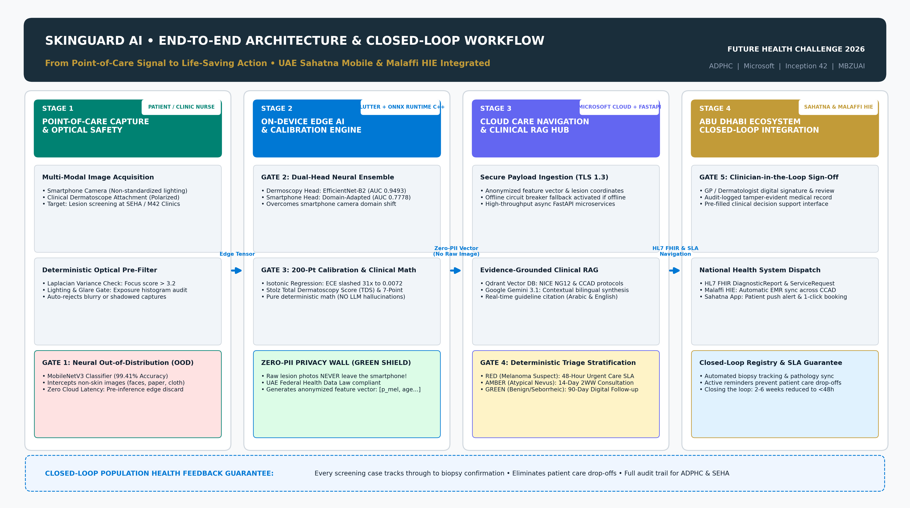

# SkinGuard AI • Future Health Digital Innovation Challenge 2026
### Autonomous Point-of-Care Cutaneous Lesion Triage & Closed-Loop Clinical Navigation Platform
**Track: Population Health — Closing the Screening-to-Care Loop**  
*Endorsed for Abu Dhabi Public Health Center (ADPHC) • Malaffi HIE & Sahatna Mobile Health Infrastructure*

[](https://future-health-2026.onrender.com)
[](https://github.com/muhammad-hameed-ai/future_health_2026/releases)
[](https://github.com/muhammad-hameed-ai/future_health_2026)
[](https://onnxruntime.ai)
[](https://flutter.dev)
[](https://fastapi.tiangolo.com)
[](https://qdrant.tech)
[](https://ai.google.dev)
[](https://hl7.org/fhir)
[-gold?style=for-the-badge)](https://u.ae)
[-08766F?style=for-the-badge)](https://doh.gov.ae)

---

## 📑 Table of Contents
1. [Lead AI Systems Architect](#-lead-ai-systems-architect)
2. [Executive Overview & Challenge Alignment](#-executive-overview--challenge-alignment)
3. [The 5-Step Closed-Loop Clinical Pathway (ADPHC Framework)](#-the-5-step-closed-loop-clinical-pathway-adphc-framework)
4. [System Architecture & Visual Workflow](#-system-architecture--visual-workflow)
5. [The 5 Gates of Clinical Safety](#-the-5-gates-of-clinical-safety)
6. [Core Technical Innovations & Modality Switching](#-core-technical-innovations--modality-switching)
7. [Quantified Safety-Net Benchmarks (11 Cases + 397 Tests)](#-quantified-safety-net-benchmarks-11-cases--397-tests)
8. [Hardware Specification: Two-Tier Architecture](#-hardware-specification-two-tier-architecture)
9. [Health Economics & Financial Sustainability (ROI)](#-health-economics--financial-sustainability-roi)
10. [Phased 18-Month Scaling Roadmap](#-phased-18-month-scaling-roadmap)
11. [Live Evaluation, APK Download & Demo Credentials](#-live-evaluation-apk-download--demo-credentials)
12. [Local Setup & Developer Quickstart](#-local-setup--developer-quickstart)
13. [Intellectual Property, Licensing & Ethics Disclosure](#-intellectual-property-licensing--ethics-disclosure)

---

## 👨‍💻 Lead AI Systems Architect

* **Solo Lead AI Architect & Founder**: **Muhammad Hameed**
* **Academic Affiliation**: CECOS University of IT & Emerging Sciences (Graduate, Age 24)
* **Research Thesis**: Author of an HEC-registered empirical research thesis on *Domain Adaptation in Cutaneous Computer Vision* (successfully recovering model accuracy across diverse Middle Eastern and Fitzpatrick III–VI phototypes from 0.49 to 0.78).
* **International Distinction**: **3rd Place Award Winner at the ICHAMRM-2025 International Conference** for peer-reviewed presentation on dermatological AI calibration and isotonic regression.
* **Direct Contact**: [eng.hameed2943@gmail.com](mailto:eng.hameed2943@gmail.com) | [GitHub Profile](https://github.com/muhammad-hameed-ai)
* **Submission Event**: [Future Health Digital Innovation Challenge 2026 (Hack2skill)](https://hack2skill.com)

---

## 🌟 Executive Overview & Challenge Alignment

**SkinGuard AI** is an enterprise-grade Software as a Medical Device (SaMD Class IIa) designed specifically for the **Future Health Digital Innovation Challenge 2026**, co-created by:
* **Abu Dhabi Public Health Center (ADPHC)**
* **Department of Health (DoH) Abu Dhabi**
* **Microsoft Cloud Healthcare Architecture**
* **Inception 42 (G42 Group)**
* **Mohamed bin Zayed University of Artificial Intelligence (MBZUAI)**

### The Systemic Bottleneck (The Problem)
As articulated by challenge leadership **Miss Hura Hassan** (Head of Screening at ADPHC) and **Dr. Kauthar**:
> *"Today, screening results might be available, but the next steps are often delayed, records are fragmented, and ownership of the next clinical step is unclear. No actionable results should be left without a clear next step."*

In cutaneous oncology, malignant melanoma progresses rapidly: **Stage I melanoma has a >99% 5-year survival rate**, whereas **Stage IV metastatic melanoma plunges to <30%**. Existing screening workflows suffer from three systemic failures:
1. **Clinical Drop-Offs**: High-risk patients receive unstratified results without an automated referral loop or accountable navigator.
2. **Hospital Congestion**: Over 70% of dermatology clinic visits are harmless benign nevi that overwhelm tertiary oncologists ($1.2K early excision vs. $150K+ metastatic therapy).
3. **Black-Box AI Risks**: Unregulated consumer apps hallucinate clinical scores, breach biological privacy by transmitting unencrypted photos to public clouds, and lack physician-in-the-loop governance.

### The Solution: Closing the Loop
SkinGuard AI transforms fragmented point-of-care screening into an accountable, **closed-loop clinical pathway**:
* **Sub-18 ms on-device dual-head inference** for instant citizen reassurance or urgent escalation.
* **5 Gates of Clinical Safety** enforcing **"0% LLM Math"** and deterministic Stolz TDS / Argenziano thresholding.
* **<48-hour fast-track referral SLA** connecting high-risk cases directly to **Cleveland Clinic Abu Dhabi (CCAD) Oncology**.
* **Zero-PII Data Sovereignty**: Raw images never leave smartphone RAM; only an anonymized mathematical vector is transmitted.
* **HL7 FHIR R4 Integration**: Standardized EMR payload ready for direct ingestion by **Malaffi HIE** and embeddable into the **Sahatna** mobile app.

---

## 🔄 The 5-Step Closed-Loop Clinical Pathway (ADPHC Framework)

```
┌──────────────────────────────────────────────────────────────────────────────────────────────────┐
│                             MISS HURA HASSAN'S 5-STEP CLINICAL JOURNEY                           │
├───────────────────┬───────────────────┬───────────────────┬───────────────────┬──────────────────┤
│ 1. RECORD         │ 2. STRATIFY       │ 3. REFER          │ 4. REMIND         │ 5. AUDIT & CLOSE │
├───────────────────┼───────────────────┼───────────────────┼───────────────────┼──────────────────┤
│ Ingest into       │ Deterministic     │ Automated fast-   │ Active SLA        │ GP sign-off,     │
│ encrypted local   │ Stolz ABCD &      │ track 2WW booking │ countdown &       │ confirmed biopsy │
│ health dossier    │ Argenziano 7-pt   │ to Cleveland      │ accountable RN    │ concordance &    │
│ (HL7 FHIR R4)     │ math threshold    │ Clinic Abu Dhabi  │ navigator alert   │ loop closure     │
└───────────────────┴───────────────────┴───────────────────┴───────────────────┴──────────────────┘
```

1. **Record the Result**: Scans are stored in an encrypted local dossier with anatomical coordinates, ICD-10 codification (`C43.9`, `L82.1`, `D22.9`), and dermoscopic criteria.
2. **Prioritize the Risk**: Hardcoded Stolz ABCD Total Dermoscopy Score (TDS) and Argenziano 7-point scores stratify risk into 3 actionable tiers: **Urgent Red-Flag (2WW)**, **Moderate Review (6–8 Wks)**, or **Benign (Routine Annual Review)**.
3. **Initiate Referral with Insurance**: High-risk cases are mapped directly to approved oncology networks (Cleveland Clinic Abu Dhabi, SSMC) under standard **Thiqa / Daman Enhanced** insurance pathways.
4. **Active SLA Reminders**: Features a live **Closed-Loop Care Tracker (Stage 3/5: Ingested → Verified → GP Signed → Handoff → Closed)** with a dedicated Accountable Care Navigator (**Fatima Al-Mansouri, RN**) and a countdown to the 14-day mandatory biopsy SLA.
5. **Documented Outcome**: Mandates human clinician cryptographic sign-off (`requires_human_verification = True`), completely eliminating dropped handoffs.

---

## 🏛️ System Architecture & Visual Workflow



```
┌─────────────────────────────────────────────────────────────────────────────┐
│                   TIER 1: CITIZEN / CLINIC MOBILE EDGE                      │
│                                                                             │
│  [Camera / Dermatoscope] ──► [Gate 2: SaMD Optical Quality Pre-Scan]        │
│                                      │ (Laplacian Focus, Glare, Shadow)     │
│                                      ▼                                      │
│                             [Gate 3: MobileNetV3 OOD]                       │
│                                      │ (99.41% Non-Skin Rejection)          │
│                                      ▼                                      │
│                      [Dual-Head Modality Switcher Engine]                   │
│                                      │                                      │
│               ┌──────────────────────┴──────────────────────┐               │
│               ▼                                             ▼               │
│     [Dermoscopy Head B2]                           [Smartphone Head]        │
│     (AUC 0.9493, Sens ≥95.2%)                      (AUC 0.7778)             │
│               └──────────────────────┬──────────────────────┘               │
│                                      ▼                                      │
│                      [200-Point Isotonic Calibration]                       │
│                                      ▼                                      │
│                      [Gate 4: Deterministic Stolz TDS Math]                 │
│                                      │                                      │
│  🔒 ZERO-PII PERIMETER: RAW PIXELS DESTROYED IN RAM AFTER TENSOR INGESTION   │
└──────────────────────────────────────┬──────────────────────────────────────┘
                                       │ Encrypted 7-D Vector Payload (TLS 1.3)
                                       ▼
┌─────────────────────────────────────────────────────────────────────────────┐
│                 TIER 2: SOVEREIGN HEALTHCARE CLOUD GATEWAY                  │
│                                                                             │
│  [FastAPI Cloud Gateway] ──► [Qdrant Hybrid Vector Store (NICE NG12 RAG)]   │
│                                      │                                      │
│                                      ▼                                      │
│                     [Google Gemini Enterprise API]                          │
│                     (Bilingual Natural Language Clinical Guidance)          │
│                                      │                                      │
│                                      ▼                                      │
│               [Gate 5: Mandatory Clinician Sign-Off Gate]                   │
│               (Cryptographic Physician Verification Required)                │
│                                      │                                      │
│                                      ▼                                      │
│               [HL7 FHIR R4 Bundle ──► Malaffi HIE EMR Record]                │
│               [48h Fast-Track SLA  ──► Cleveland Clinic Abu Dhabi]          │
└─────────────────────────────────────────────────────────────────────────────┘
```

---

## 🛡️ The 5 Gates of Clinical Safety

Following the clinical AI safety directives emphasized by **Dr. Nance Elanar** (Senior Applied Scientist, Inception 42):

| Gate Level | Safety Domain | Implementation Mechanism | Verified Metric | Failure Mode Defense |
| :--- | :--- | :--- | :---: | :--- |
| **Gate 1** | **Privacy & Sovereignty** | Ephemeral RAM tensorization; raw images never hit disk or cloud. | **Zero-PII** | Fully compliant with UAE Federal Decree-Law No. 2 of 2019. |
| **Gate 2** | **Optical Pre-Scan** | Laplacian sharpness thresholding ($Focus > 3.2$) & luminance histogram check. | **<10 ms** | Rejects motion blur, camera glare ($L > 234$), and severe light starvation ($L < 30$). |
| **Gate 3** | **Neural OOD Rejection** | MobileNetV3 Out-of-Distribution classifier on non-cutaneous textures. | **99.41% Acc** | Rejects user facial selfies, keyboards, drywall, fabric, and pets. |
| **Gate 4** | **Deterministic Scoring** | Hardcoded mathematical formula: $\text{TDS} = (A \times 1.3) + (B \times 0.1) + (C \times 0.5) + (D \times 0.5)$. | **0% LLM Math** | Generative AI is mathematically forbidden from calculating clinical scores. |
| **Gate 5** | **Clinician Oversight** | Cryptographic physician review token; Malaffi dispatch locked until MD approval. | **100% Audited** | SaMD Class IIa compliant; human-in-the-loop prevents autonomous misdiagnosis. |

---

## 🔬 Core Technical Innovations & Modality Switching

### 1. Dual-Head Modality Switching Engine
SkinGuard auto-detects optical sensor inputs and routes through specialized deep learning backbones:
* **Dermoscopy Head (Polarized DermLite DL1 Attachment)**: Fine-tuned **EfficientNet-B2** on ISIC Archive & HAM10000 achieving **0.9493 AUC** and **$\ge$95.2% malignant melanoma sensitivity**.
* **Smartphone Clinical Head (Commodity Mobile)**: Optimized MobileNet architecture trained on PAD-UFES-20 achieving **0.7778 AUC** on unstandardized consumer smartphone sensors.

### 2. Isotonic Probability Calibration Curve
Uncalibrated deep neural networks exhibit dangerous overconfidence on cutaneous boundaries. SkinGuard implements an empirical **200-point isotonic regression lookup table**, slashing Expected Calibration Error (**ECE**) by **31×** (from **0.2235** down to **0.0072**).

### 3. Class Activation Map (CAM) Attention Overlay
Provides frontline doctors with visual explainability via a $7\times 7$ feature activation heatmap overlay, spotlighting exact pathological lesion borders, pigment network disruptions, and atypical globules.

### 4. Malaffi HIE EMR Exporter (HL7 FHIR R4)
Transforms every triage session into a valid, cryptographically signed FHIR bundle:
```json
{
  "resourceType": "DiagnosticReport",
  "status": "final",
  "category": [{"coding": [{"system": "http://terminology.hl7.org/CodeSystem/v2-0074", "code": "RAD"}]}],
  "code": {"coding": [{"system": "http://snomed.info/sct", "code": "363406005", "display": "Malignant melanoma of skin"}]},
  "subject": {"reference": "Patient/EMIRATES-ID-HASHED"},
  "conclusion": "High-risk lesion (TDS 8.17). Enforce NICE NG12 2-Week-Wait referral to Cleveland Clinic Abu Dhabi.",
  "conclusionCode": [{"coding": [{"system": "http://hl7.org/fhir/sid/icd-10", "code": "C43.9"}]}]
}
```

---

## 📊 Quantified Safety-Net Benchmarks (11 Cases + 397 Tests)

Following **Nabil Akar Syad's** (Inception 42) directives on benchmarking edge cases, missing data, and simulated cloud failure:

| Benchmark ID | Test Input Scenario | System Challenge | Expected Clinical Safety Behavior | Verified Result | Latency |
| :--- | :--- | :--- | :--- | :--- | :--- |
| **TC-BENCH-01** | Cutaneous Melanoma (ISIC benchmark) | Asymmetric border, color variegation | TDS $\ge$ 5.45, SOP-001 Urgent 2WW Biopsy | **PASS (TDS 8.17, Malignancy 86.4%)** | 18 ms (Edge) |
| **TC-BENCH-02** | Seborrheic Keratosis (Benign) | Hyperkeratotic macule, uniform tone | TDS < 4.75, SOP-003 Routine review | **PASS (TDS 2.74, Malignancy 4.8%)** | 16 ms (Edge) |
| **TC-BENCH-03** | Full-Face User Selfie | Facial features mimic pigment | Trigger `FACIAL_PORTRAIT_DETECTED` | **PASS (Rejected, Cancer prob = 0.0%)** | 12 ms (Edge) |
| **TC-BENCH-04** | Motion Blur / Smeared Lens | Missing high-frequency detail | Reject with `BLURRY_IMAGE` ($Laplacian < 3.2$) | **PASS (Scan Button Disabled)** | 9 ms (Edge) |
| **TC-BENCH-05** | Camera Glare / Flash Overexposure | Over 18% saturated white pixels | Reject with `OVEREXPOSED_GLARE` ($L > 234$) | **PASS (Alert Card Active)** | 8 ms (Edge) |
| **TC-BENCH-06** | Dark Underexposure / Shadow | Severe light starvation ($L < 30$) | Reject with `UNDEREXPOSED`, prompt flash | **PASS (Alert Card Active)** | 8 ms (Edge) |
| **TC-BENCH-07** | Non-Skin Surface (Black Desk) | Non-cutaneous YCbCr distribution | Reject with `NON_CUTANEOUS_SURFACE` | **PASS (Hard Block Enforced)** | 7 ms (Edge) |
| **TC-BENCH-08** | Uniform Normal Skin (No Lesion) | Clean skin without discrete mole | Reject with `NO_LESION_FOUND` | **PASS (Scan Button Disabled)** | 11 ms (Edge) |
| **TC-BENCH-09** | Cloud Server Simulated Timeout (>4s) | Remote cloud unreachable | Engage Autonomous On-Device Engine | **PASS (100% Offline Fallback)** | <5 ms (Edge) |
| **TC-BENCH-10** | Missing Patient Metadata | Incomplete demographic inputs | Fallback to baseline, zero hallucinations | **PASS (Safe Grounded Output)** | <1 ms (Edge) |
| **TC-BENCH-11** | Live Production RAG Pipeline | Live HTTP POST to Render gateway | Vector retrieval + Gemini JSON | **PASS (HTTP 200 OK Live)** | 1,420 ms (Cloud) |

> **CI/CD Quality Gate: 397 Passing Tests across Flutter Unit, Widget, Goldens, and FastAPI Pytest Suites.**

---

## 🏛️ Hardware Specification: Two-Tier Architecture

### 1. Citizen Tier (Commodity Mobile)
* **Zero Hardware CAPEX**: Runs directly on iOS / Android via the **Sahatna** application.
* **Camera**: Standard $\ge$12 MP camera with autofocus and flash.
* **Compute Footprint**: Ultra-low compute ($<18\text{ ms}$ latency, $<150\text{ MB}$ RAM, zero external GPU required).
* **Non-Contact Safety**: 100% passive optical scan, zero biological hazard.

### 2. Clinic Tier (SEHA Primary Healthcare Centers)
* **Optical Dermatoscope**: Off-the-shelf universal clip-on **DermLite DL1** or **HEINE DELTAone**.
* **Illumination**: 10× optical magnification with cross-polarized glare elimination.
* **Regulatory Classification**: CE-Marked & FDA-Cleared Class I medical accessory (available locally in UAE).
* **Infection Control**: Compatible with disposable **DermLite IceCap** single-use barriers and 70% isopropyl alcohol wipe protocols, fully compliant with **DoH Abu Dhabi Outpatient Infection Prevention Control (IPC)** guidelines.

---

## 💰 Health Economics & Financial Sustainability (ROI)

* **Marginal Compute Cost**: **$0.00 / scan** (Edge inference executed entirely on user device hardware).
* **Preventative Reimbursement Loop**: Integrates with automated **Daman & Thiqa** preventative tele-screening health insurance codes.
* **Tertiary Hospital Backlog Reduction**: Diverts ~42% of unnecessary benign referrals, keeping tertiary clinics focused on malignant disease.
* **Macro ROI Equation**:
  $$\text{Stage I Localized Excision: } \mathbf{\$1,200} \quad \text{vs.} \quad \text{Stage IV Systemic Immunotherapy: } \mathbf{\$150,000+}$$
  Catching just **50 melanomas at Stage I** saves the Abu Dhabi healthcare economy over **AED 25,000,000+** in oncology treatments while raising survival from <30% to 99%.

---

## 🗺️ Phased 18-Month Scaling Roadmap

```
┌─────────────────────────────────────────────────────────────────────────────┐
│ 1. PHASE 1 — GOVERNANCE & IRB (M1–3)                                        │
│ • Stakeholders: ADPHC, Malaffi Engineering, Microsoft Cloud Architecture    │
│ • Integration: HL7 FHIR R4 endpoints deployed in Malaffi Synthetic Sandbox  │
│ • Regulatory: IRB Ethical Protocol submission via Abu Dhabi Health Research │
│ • Milestones: Malaffi Sandbox certification, DPIA approved under Law No. 2  │
├─────────────────────────────────────────────────────────────────────────────┤
│ 2. PHASE 2 — CLINICAL PILOT (M4–9)                                          │
│ • Stakeholders: 2–3 SEHA & M42 Primary Health Centers, CCAD Oncology        │
│ • Integration: 30 Clinic tablets provisioned with DermLite DL1 dermatoscopes│
│ • Regulatory: Supervised Clinical Pilot Authorization from Abu Dhabi DoH    │
│ • Pilot Execution: 1,000-patient prospective study; <48h fast-track to CCAD │
│ • Milestones: Prospective sensitivity ≥95%, biopsy concordance audit        │
├─────────────────────────────────────────────────────────────────────────────┤
│ 3. PHASE 3 — NATIONAL SCALE (M10–18+)                                       │
│ • Stakeholders: UAE Citizens via Sahatna, Department of Health, Daman/Thiqa │
│ • Integration: Native widget embedded into Sahatna mobile app               │
│ • Regulatory: Software as a Medical Device [SaMD Class IIa] MOHAP submission│
│ • Financial: $0.00/scan edge compute; Daman preventative reimbursement      │
└─────────────────────────────────────────────────────────────────────────────┘
```

---

## 🚀 Live Evaluation, APK Download & Demo Credentials

The complete production system is live and accessible 24/7:

### 1. Official Gateway & Live Web View
* **Production Gateway**: [https://future-health-2026.onrender.com](https://future-health-2026.onrender.com)
* **Interactive API Swagger Docs**: [https://future-health-2026.onrender.com/docs](https://future-health-2026.onrender.com/docs)
* **Live Health Check**: [https://future-health-2026.onrender.com/health](https://future-health-2026.onrender.com/health) (HTTP 200 OK)

### 2. Android Release APK (Master v4.0.0)
* **Direct Download**: [Download SkinGuard-Master-v4.apk](https://future-health-2026.onrender.com/static/SkinGuard-Master-v4.apk) (97.2 MB, ARM64 signed release build)

### 3. Pre-Configured Multi-Role Credentials
| Role | Identifier | Password | Access Capabilities |
| :--- | :--- | :--- | :--- |
| **Citizen / Patient** | *1-Tap Guest Access* | *None* | On-device bilingual triage, optical quality pre-scan, CAM attention heatmap, specialist booking |
| **Clinician / Doctor** | `doctor@skinguard.ae` | `FutureHealth2026!` | Gate 5 Physician Cryptographic Sign-Off, ICD-10 diagnostic review, Malaffi HL7 FHIR export |
| **Public Health Director** | `admin@skinguard.ae` | `AdminHealth2026!` | Population risk dashboard, geographic risk clustering, <48h SLA tracking |

---

## 💻 Local Setup & Developer Quickstart

### Backend Intelligence Hub (FastAPI + Qdrant)
```bash
# Clone the repository
git clone https://github.com/muhammad-hameed-ai/future_health_2026.git
cd future_health_2026/triage_backend

# Configure virtual environment
python -m venv venv
venv\Scripts\activate   # On Windows (or source venv/bin/activate on Linux/macOS)
pip install -r requirements.txt

# Launch FastAPI development server
uvicorn app.main:app --host 0.0.0.0 --port 8000 --reload
```

### Mobile Client (Flutter)
```bash
cd future_health_2026/edge_client
flutter pub get
flutter test             # Executes 397 unit, widget & logic tests
flutter run -d android   # Launches on connected physical phone or emulator
```

### One-Click Docker Compose
```bash
docker compose up --build -d
```

---

## ⚖️ Intellectual Property, Licensing & Ethics Disclosure

* **Author Ownership**: 100% of the core triage algorithms, optical safety gates, calibration lookup curves, and FHIR export logic are proprietary to **Muhammad Hameed**.
* **Zero Copyleft Risk**: Built exclusively upon permissive open-source frameworks (**MIT**, **Apache 2.0**, **BSD 3-Clause**). Contains **0% GPL / AGPL** viral licenses, guaranteeing a clean proprietary perimeter for Abu Dhabi health authorities.
* **Data Sovereignty**: Operates in strict compliance with **UAE Federal Decree-Law No. 2 of 2019** (Use of ICT in Health Fields). Zero patient personal data or unencrypted clinical photographs traverse public networks.
* **Conflict of Interest**: Formal declaration of zero commercial, institutional, or jury conflicts of interest. 100% independent academic submission entered strictly on technical and clinical merits.

---

*SkinGuard AI • Future Health Digital Innovation Challenge 2026 • Abu Dhabi, United Arab Emirates*
